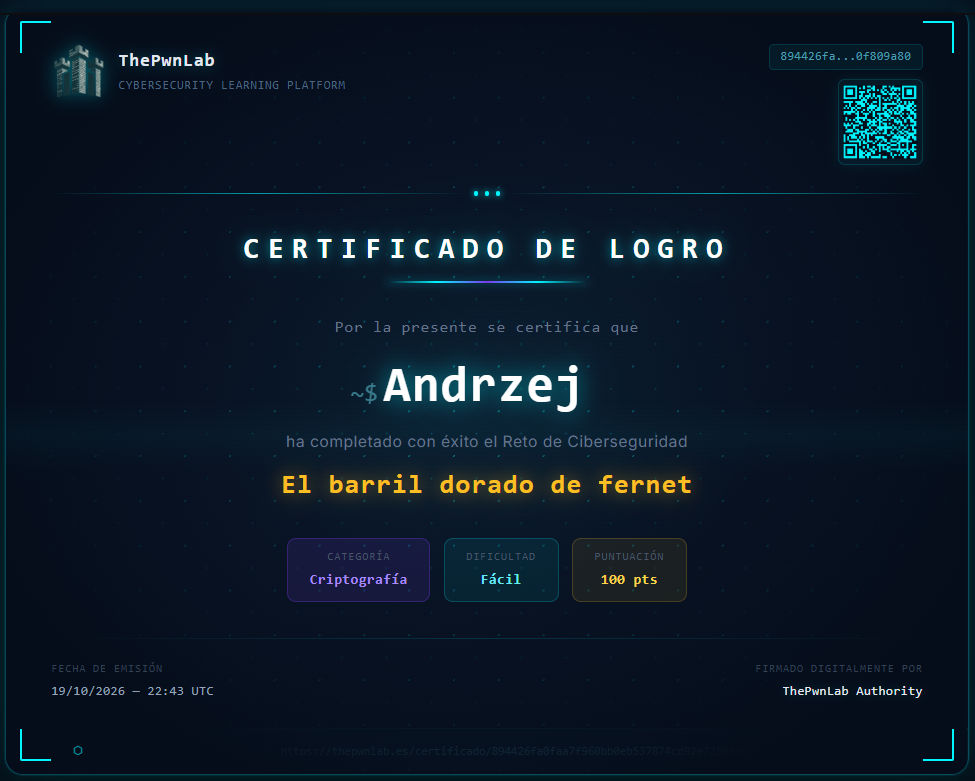

# 🛢️ El Barril Dorado de Fernet

> **Author:** Malekith · **Category:** Criptografía · **Difficulty:** 🟢 Fácil
> **Platform:** [thePwnLab](https://thepwnlab.es/retos/el-barril-dorado-de-fernet) · **Certificate issued:** 19/10/2026

A hidden golden barrel in a San Telmo cellar guards an ancient Fernet formula, protected
by an "unbreakable" code. A leak from a distillery's servers exposed an encrypted string —
the mission is to recover it and reveal the hidden message.

> 🚧 **Writeup in progress** — the solving steps below are placeholders to be filled in.
> The certificate is already earned and linked at the bottom.

---

## 01 · The challenge

Encrypted string recovered from the leaked records:

```
gAAAAABn6u19Yn3pSxJjtIjSSsa4Tfgd5VI6C2lZrIQACzm4oUQVtkyuee627i8XWJ1vlFnQUIH87r_V04ipncijG2bdRcnnNc9bCQqYqorvsob5OFipRHc=
```

**Flag format:** `TPL{xxxxxxxxxxxxxxxxxxxxxxx}`

> **Key insight —** <!-- TODO: what gave away the cipher type? -->

## 02 · Approach

<!-- TODO: identify the cipher, explain the tell, and the key/tool used to decrypt. -->

```
# TODO: the command / tool steps that produced the flag (trim the final step)
```

## 03 · Solution

<!-- TODO: the decisive step. Keep the flag masked below. -->

🚩 **Flag retrieved** — `TPL{ ... }`

---

## How I got there

<!-- TODO: reasoning chain, one line per move -->
1. **<!-- move -->.** <!-- why it followed -->
2.
3.

---

## 🏅 Certificate

Challenge completed on **[thePwnLab](https://thepwnlab.es/retos)**.



🔗 **[Verify this certificate](https://thepwnlab.es/certificado/894426fa0faa7f960bb0eb537874cd92e72558d8078d17cb02d276190f809a80)**

---

*Author: Andrzej Banas · Educational writeup.*
