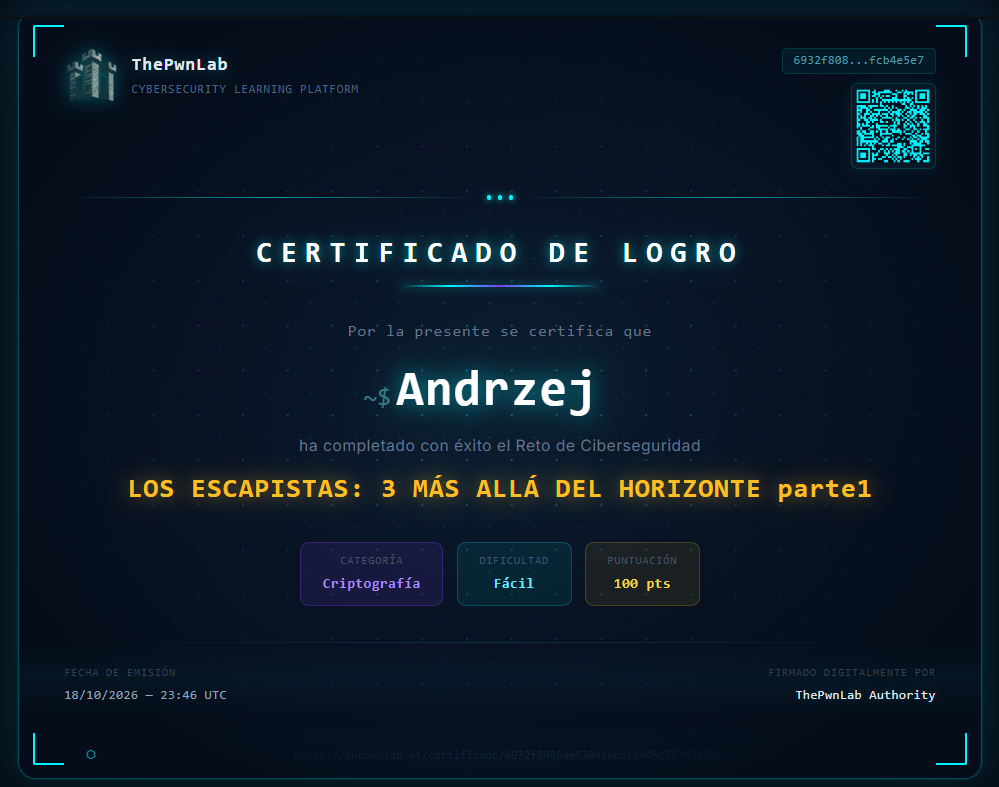

# 🧩 Los Escapistas 3: Más Allá del Horizonte (parte 1)

> **Category:** Criptografía · **Difficulty:** Fácil · **Platform:** [thePwnLab](https://thepwnlab.es/retos)
> **Certificate issued:** 18/10/2026

<!-- TODO: one or two sentences summarizing the challenge and how it was solved. -->
*Writeup in progress — notes and screenshots to be added.*

---

## 01 · Recon

<!-- TODO: what the challenge gives you (files, text, cipher, hints). Drop a screenshot: -->
<!--  -->

> **Key insight —** <!-- TODO: the observation that pointed to the approach -->

## 02 · Approach

<!-- TODO: the technique / cipher identified and why. -->
<!-- For crypto: name the cipher, the tell that identified it, the tool or method used. -->

```
# TODO: key commands / tool output (trim to the essential lines)
```

## 03 · Solution

<!-- TODO: the decisive step that produced the flag. Keep the final step trimmed. -->

🚩 **Flag retrieved** — `PREFIX{ ... }`

---

## How I got there

<!-- TODO: the reasoning chain, one line per move -->
1. **<!-- move -->.** <!-- why it followed -->
2.
3.

---

## 🏅 Certificate

Challenge completed on **[thePwnLab](https://thepwnlab.es/retos)**.



🔗 **[Verify this certificate](https://thepwnlab.es/certificado/6932f8086ae63041eeb18045c7f747278ed0be2d1dd9ca0b0f35bcfbfcb4e5e7)**

---

*Author: Andrzej Banas · Educational writeup.*
